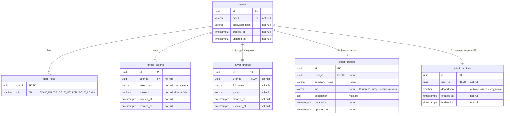
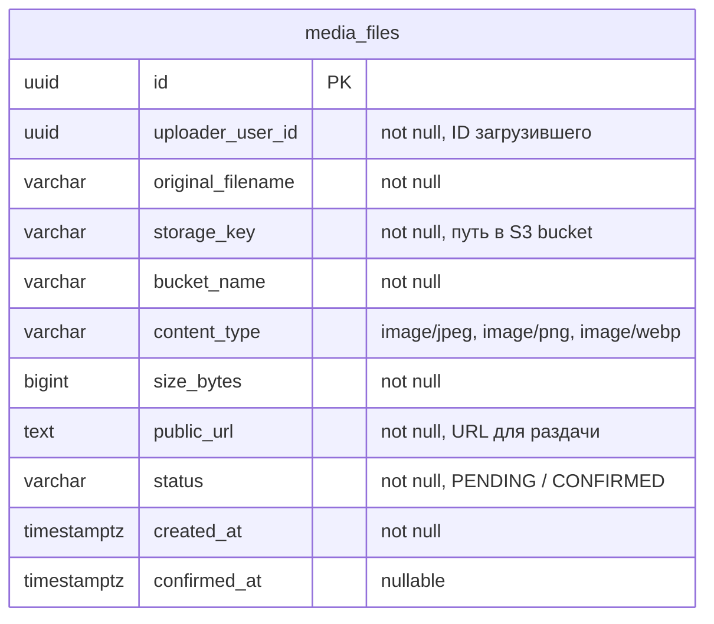
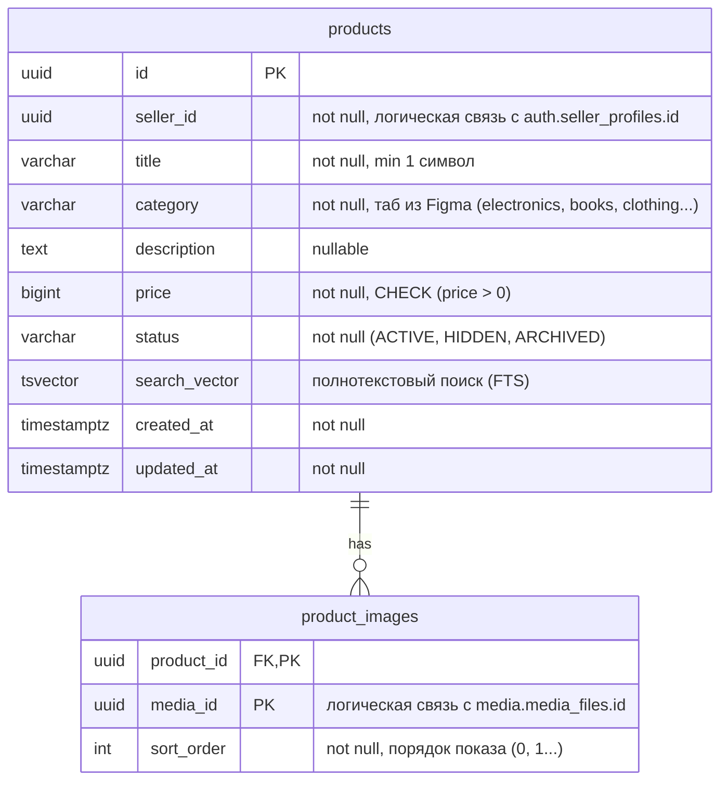
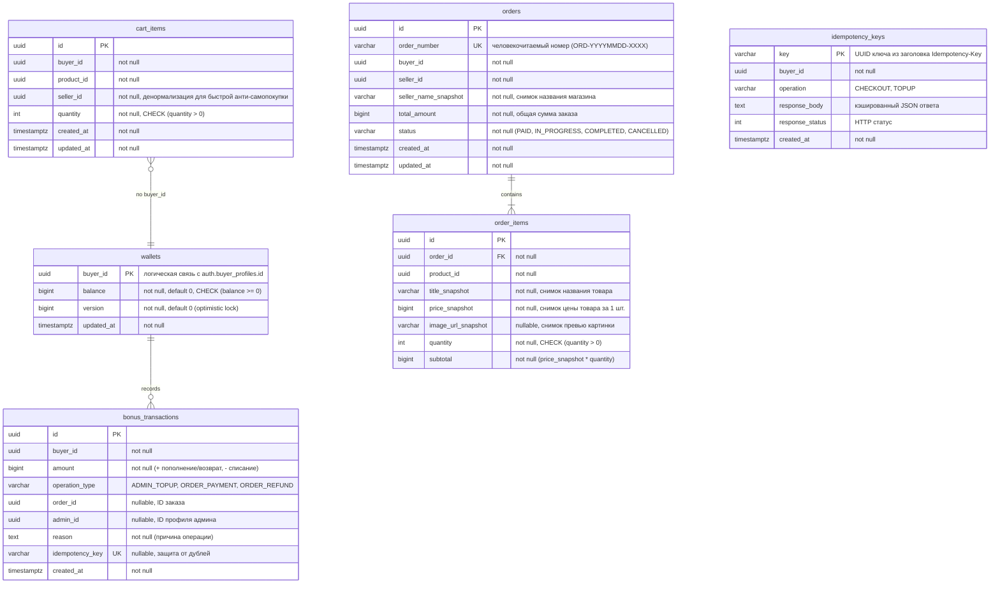

# Модель данных и ER-диаграммы микросервисов — Мобильный маркетплейс

**Проект:** Мобильный маркетплейс  
**База данных:** PostgreSQL 16+ (Архитектурный паттерн *Database-per-Service* на уровне логических схем: `auth`, `media`, `catalog`, `commerce`)  
**Первичные ключи:** `UUID` (исключает коллизии между распределёнными сервисами и предсказуемый перебор ID)  
**Денежный тип:** `BIGINT` (суммы в бонусах хранятся целыми числами, исключая погрешности чисел с плавающей точкой)

---

## 1. Схема `auth` (Auth & Profile Service)

Отвечает за учётные записи, сессии (JWT / HttpOnly cookie) и три типа профилей (Покупатель, Продавец, Администратор).

### Ключевые инварианты схемы `auth`:

1. **R-12:** `buyer_profiles` создаётся строго в одной транзакции при регистрации `users`. У каждого пользователя гарантированно есть `buyer_id`.
2. **US-1.2:** Поле `inn` валидируется регулярным выражением (`^\d{10}$|^\d{12}$`) и защищено от изменения после создания профиля.
3. **Безопасность (PR-05):** `admin_profiles` создаётся только административной процедурой вне публичного API.
4. **Logout и ротация токенов:** Таблица `refresh_tokens` позволяет отозвать сессию при выходе (`POST /auth/logout`) установкой `revoked = true`.

---

## 2. Схема `media` (Media Service)

Изолированное хранилище метаданных файлов. Поддерживает паттерн прямой загрузки в MinIO через **Presigned URLs** (бэкенд не нагружается бинарным трафиком).

### Жизненный цикл медиафайла:

- `PENDING`**:** Выдана ссылка `uploadUrl` для прямого `PUT` клиентом в MinIO (TTL ссылки 15 минут).
- `CONFIRMED`**:** Клиент вызвал `POST /api/v1/media/{id}/confirm`, сервис проверил наличие файла в S3 (`HeadObject`) и подтвердил готовность к использованию в карточке товара.

---

## 3. Схема `catalog` (Catalog & Search Service)

Каталог товаров с категориями (табы из Figma) и защитой истории заказов.

---

## 4. Схема `commerce` (Commerce Service: Cart, Wallet, Orders)

Финансовый контур маркетплейса: кошелёк с журналом транзакций, корзина, заказы со снимками и защита от повторов.

### Защита бизнес-инвариантов в `commerce`:

1. **R-14 (Инвариант баланса):** Ограничение `CHECK (balance >= 0)`. Списание/начисление и создание записи в `bonus_transactions` выполняются строго в одной транзакции:
   `balance = sum(bonus_transactions.amount)`
2. **R-02, US-5.3 AC 5 (Неизменяемость истории):** В `order_items` сохраняются снимки `title_snapshot`, `price_snapshot`, `image_url_snapshot`, а в `orders` — `seller_name_snapshot`. Последующие правки в каталоге не меняют старые чеки.
3. **R-06 (Сумма возврата):** При отмене заказа сумма возврата берётся исключительно из `orders.total_amount` (по снимку), а не по текущей цене товара в каталоге.
4. **US-3.4 (Защита от удаления товара):** Перед физическим удалением товара проверяется наличие записей в `order_items`. Если товар когда-либо заказывался, удаление блокируется (`409 Conflict`), и товар переводится в `ARCHIVED`.
