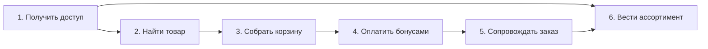

# User Story Map

Источник: [user_stories.md](./user_stories.md)

**Цель покупателя:** найти товар и купить его за бонусы.  
**Цель продавца:** выставить свои товары и обработать свои заказы.  
**Цель админа:** начислять бонусы и работать с любыми товарами и заказами.

---

## Backbone

Слева направо — шаги сценария. Сверху вниз в таблице — раньше / важнее для сквозного потока.

---

## Карта

| | 1. Получить доступ | 2. Найти товар | 3. Собрать корзину | 4. Оплатить бонусами | 5. Сопровождать заказ | 6. Вести ассортимент |
|---|---|---|---|---|---|---|
| **Задачи** | Зарегистрироваться как покупатель | Смотреть каталог и карточку | Добавить, изменить, удалить позиции | Начислить бонусы | Обработать заказ | Создать и править товар |
| | Войти в аккаунт | Найти, отфильтровать, отсортировать | Посмотреть состав и сумму | Оплатить корзину | Смотреть свои покупки | Смотреть список своих / всех товаров |
| | Стать продавцом | | | Смотреть баланс и историю | Отменить заказ и вернуть бонусы | Загрузить фото |
| | Дозаполнить профиль | | | | | Скрыть, удалить или архивировать |
| **Сквозной поток** | **US-1.1** Регистрация покупателя | **US-2.1** Каталог и карточка | **US-4.1** Корзина | **US-5.1** Начисление бонусов админом | **US-6.3** Статусы продавца и админа | **US-3.3** Создание и редактирование товара |
| | **US-1.3** Вход и refresh JWT | | | **US-5.3** Чекаут и списание | | |
| **Остальной MVP** | **US-1.2** Профиль продавца | **US-2.2** Поиск, фильтры, сортировка | | **US-5.2** Баланс и история бонусов | **US-6.1** История покупок | **US-3.1** Загрузка изображений |
| | **US-1.4** Редактирование профилей | | | | **US-6.2** Отмена и возврат | **US-3.2** Список товаров в ЛК |
| | | | | | | **US-3.4** Скрытие и архивация |

Роль `ADMIN` не создаётся регистрацией. В глоссарии: первое назначение админа — миграцией или защищённой процедурой вне публичного API. Без этого не выполняется US-5.1.

По US-1.1 повтор email даёт `409 Conflict`. Это критерий приёмки регистрации, не отдельная карточка карты.

---

## Срезы

Все карточки выше — MVP из спецификации. Срезы только упорядочивают те же `US-*`.

**Сквозной поток** — минимальный путь «товар → оплата → статус»:

`US-1.1 → US-1.3 → US-3.3 → US-2.1 → US-5.1 → US-4.1 → US-5.3 → US-6.3`

**Остальной MVP** — закрывает спецификацию целиком:

`US-1.2, US-1.4, US-2.2, US-3.1, US-3.2, US-3.4, US-5.2, US-6.1, US-6.2`

---

## Состав карты

| ID | Активность | Роль |
|---|---|---|
| US-1.1 | Получить доступ | Гость → Покупатель |
| US-1.2 | Получить доступ | Гость / Покупатель → Продавец |
| US-1.3 | Получить доступ | Пользователь |
| US-1.4 | Получить доступ | Покупатель, Продавец |
| US-2.1 | Найти товар | Гость, Пользователь |
| US-2.2 | Найти товар | Гость, Пользователь |
| US-3.1 | Вести ассортимент | Продавец, Админ |
| US-3.2 | Вести ассортимент | Продавец, Админ |
| US-3.3 | Вести ассортимент | Продавец, Админ |
| US-3.4 | Вести ассортимент | Продавец, Админ |
| US-4.1 | Собрать корзину | Покупатель |
| US-5.1 | Оплатить бонусами | Админ |
| US-5.2 | Оплатить бонусами | Покупатель |
| US-5.3 | Оплатить бонусами | Покупатель |
| US-6.1 | Сопровождать заказ | Покупатель |
| US-6.2 | Сопровождать заказ | Покупатель |
| US-6.3 | Сопровождать заказ | Продавец, Админ |
